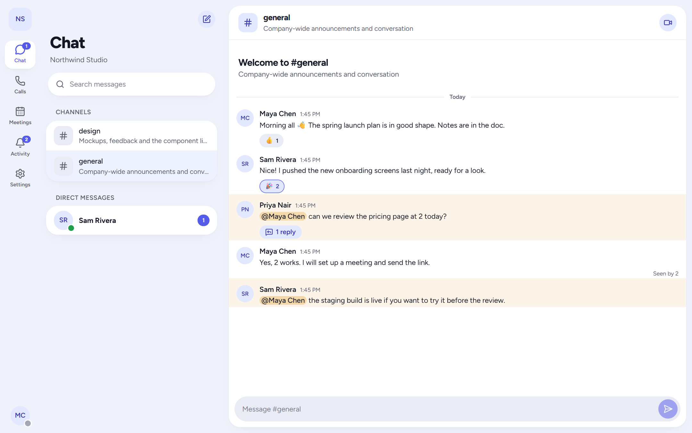
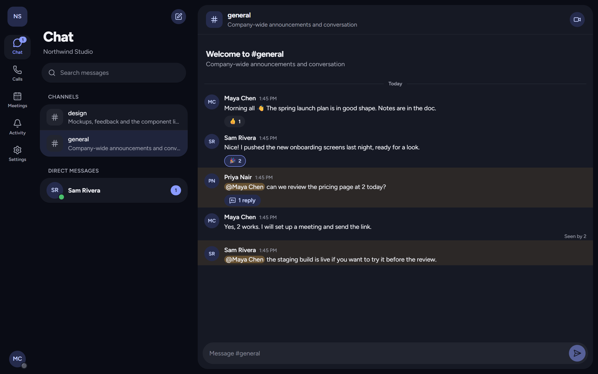
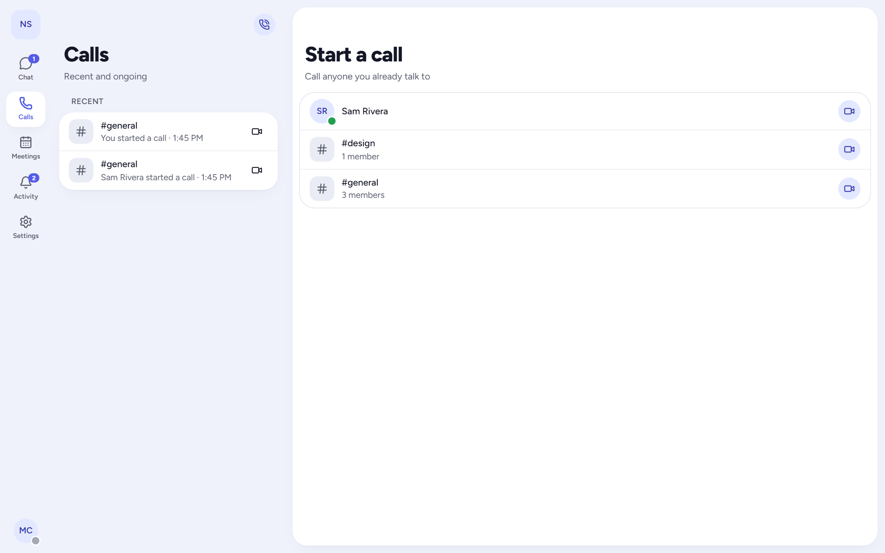
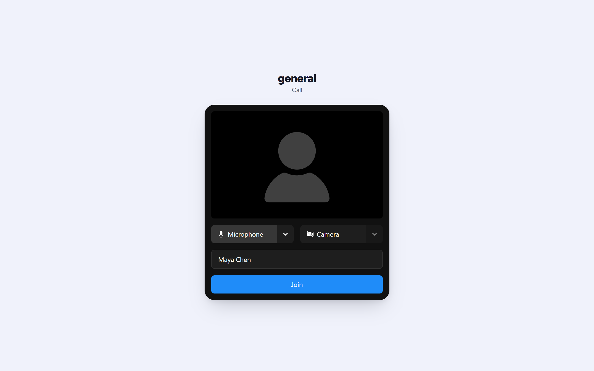
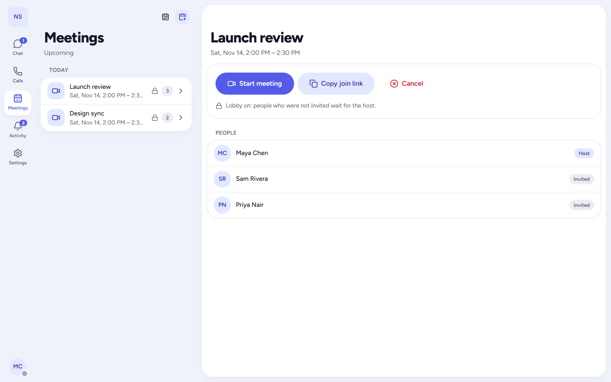
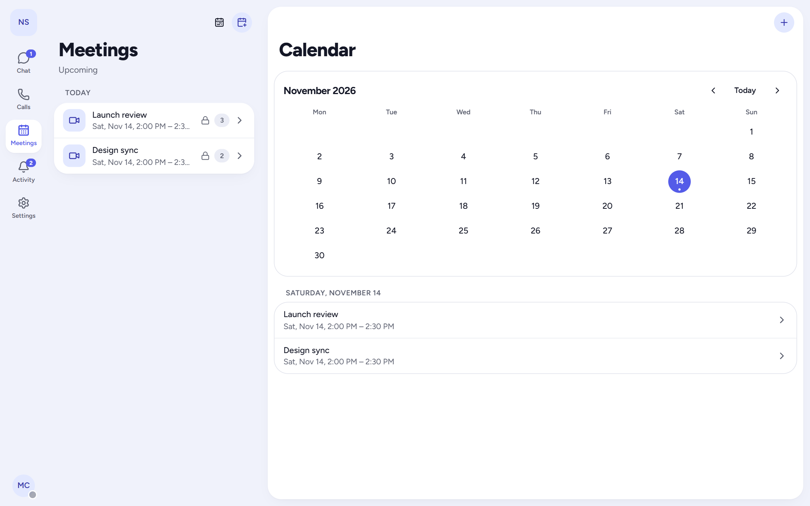
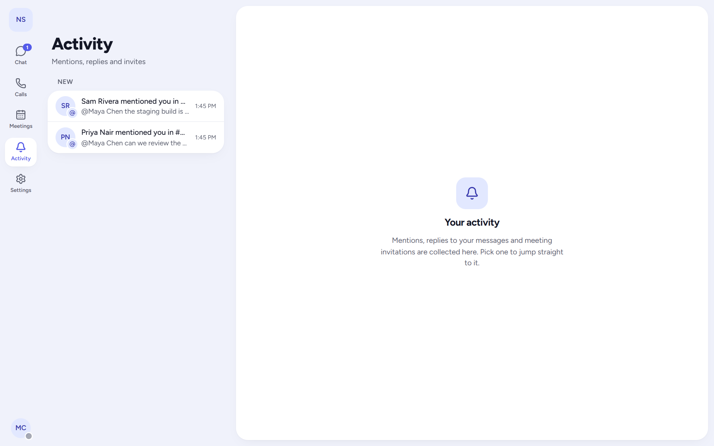
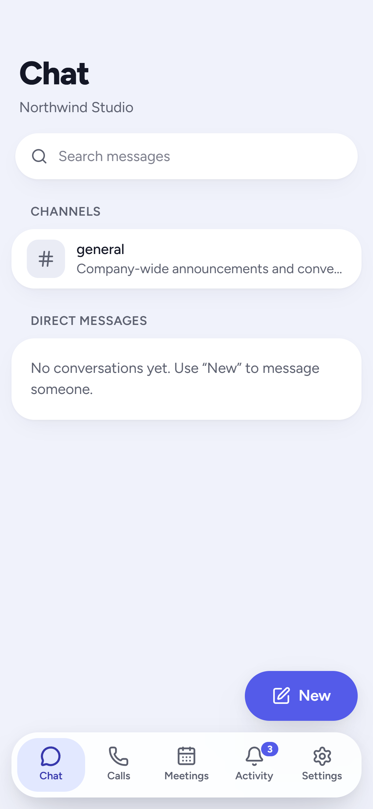
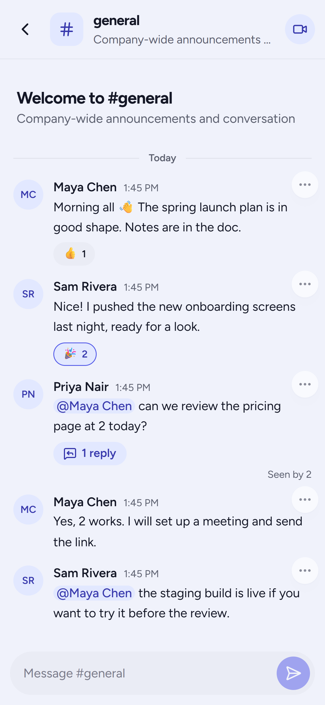
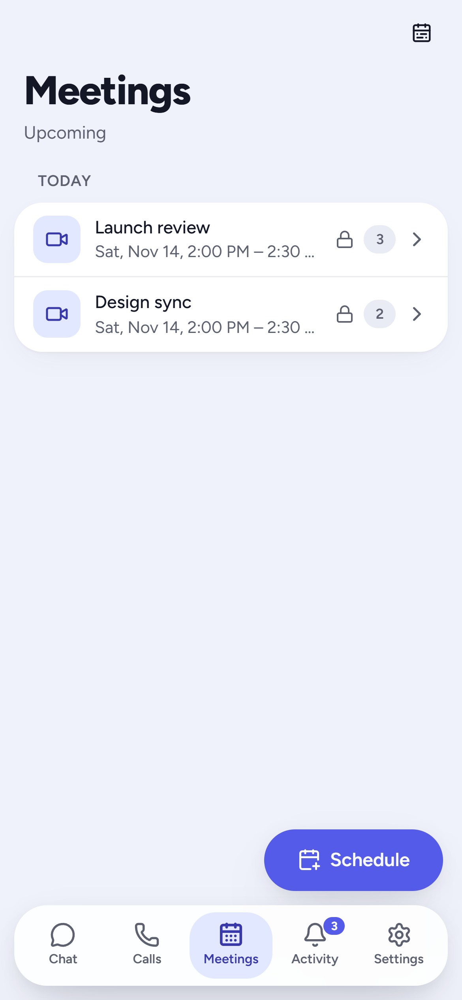

# Orbit

**Source code: <https://github.com/reddypranith80-max/messenger-agent>**

Team messenger and meetings SaaS. The product brief, stack and build phases are in [CLAUDE.md](CLAUDE.md).

**Status: phases 1 to 4 of 8, plus the in-app half of phase 5.**

| Area | State |
| --- | --- |
| Accounts, workspaces, roles, invitations | Working. Rename, leave and delete a workspace from Settings. |
| Chat | Working: channels, direct and group messages, threads, reactions, mentions, edit and delete, typing, read receipts, unread counts, message search. |
| Calls | Working once LiveKit keys are set (see below): 1:1 and group audio/video, screen share, device picker, in-call chat, raise hand, call history. |
| Meetings | Working: schedule, invite, join link, lobby, calendar. Email invitations and reminders go out once a Resend key is set. |
| Activity | Working in the app: mentions, replies and invitations, with a live banner and an unread badge. |
| Not built yet | File attachments, browser push and email digest, recording, calendar sync, webhooks and API tokens, billing, audit log. See [Not built yet](#not-built-yet). |

## Screenshots

Taken from the running app with sample people and messages.

**Chat**: channels, direct messages, mentions, reactions, threads, read receipts and search.



**Dark theme**



**Calls**: call history on the left, one-click calling on the right.



**Joining a call**: microphone and camera check before you enter.



**Meetings**: a scheduled meeting with its join link, lobby and invitees, and the month calendar.





**Activity**: mentions, replies and invitations in one place.



**On a phone**: one pane at a time with navigation at the bottom.

<p>
  
  
  
</p>

## Layout

| Path | What it is |
| --- | --- |
| `apps/web` | Next.js app (App Router): pages, server actions, Clerk webhook |
| `apps/realtime` | Socket.IO service: authenticated, workspace-scoped sockets and presence |
| `packages/db` | Prisma schema and migrations, tenant-scoped client, roles and permissions |
| `packages/ui` | Design system: tokens, cards, buttons, sheet, large-title scroll pane, motion |

## Run it locally

You need [Node.js](https://nodejs.org) 22 or newer, [pnpm](https://pnpm.io/installation) (`npm install -g pnpm`),
Git, and a free [Clerk](https://dashboard.clerk.com) account.

1. Get the code and install dependencies:

   ```sh
   git clone https://github.com/reddypranith80-max/messenger-agent.git
   cd messenger-agent
   pnpm install
   ```

2. Create your environment file (`copy .env.example .env` on Windows Command Prompt):

   ```sh
   cp .env.example .env
   ```

3. Start a local database in its own terminal and leave it running. It needs no Docker. Copy the
   `postgres://...` URL it prints into `DATABASE_URL` in `.env`:

   ```sh
   pnpm db:dev
   ```

4. In the Clerk dashboard create an application, then copy its publishable key and secret key into
   `NEXT_PUBLIC_CLERK_PUBLISHABLE_KEY` and `CLERK_SECRET_KEY` in `.env`. Apply the settings under
   [Clerk settings](#clerk-settings) below.

5. Create the tables, then start the app:

   ```sh
   pnpm db:deploy
   pnpm dev
   ```

6. Open <http://localhost:3000>, sign up, and create a workspace. The realtime service runs on port 4000.

Minimum `.env` to run the app:

- `DATABASE_URL`: the URL printed by `pnpm db:dev`, or a Neon/Supabase connection string.
- `NEXT_PUBLIC_CLERK_PUBLISHABLE_KEY` and `CLERK_SECRET_KEY`: from the Clerk dashboard (API keys). The app
  returns an error on every page until these are set.

Needed for specific features. Without them the rest of the app still works and the feature says what is missing.
Step-by-step instructions for each are under [Adding service keys](#adding-service-keys):

| Feature | Variables | Used by the app today? |
| --- | --- | --- |
| Calls and meeting rooms | `LIVEKIT_URL`, `LIVEKIT_API_KEY`, `LIVEKIT_API_SECRET` | Yes |
| Meeting invitation and reminder emails | `RESEND_API_KEY`, `EMAIL_FROM` | Yes |
| More than one realtime instance | `REDIS_URL` | Yes (optional locally) |
| File attachments | `R2_ACCOUNT_ID`, `R2_ACCESS_KEY_ID`, `R2_SECRET_ACCESS_KEY`, `R2_BUCKET` | Not yet: attachments are not built |
| Billing | `STRIPE_SECRET_KEY`, `STRIPE_WEBHOOK_SECRET`, `NEXT_PUBLIC_STRIPE_PUBLISHABLE_KEY` | Not yet: billing is not built |

### Clerk settings

In the Clerk dashboard for the application:

1. **Organizations**: enable, and turn off "force organization selection" (membership optional). A Clerk
   organization is an Orbit workspace, and Orbit has its own onboarding screen for creating one.
2. **Email**: require email address with verification code at sign-up (the default), and enable password reset.
3. **Multi-factor**: enable authenticator app and/or SMS so users can turn on 2FA.
4. **Webhooks** (optional locally, required in production): endpoint `<app url>/api/webhooks/clerk` with events
   `user.*`, `organization.*`, `organizationMembership.*`; put the signing secret in `CLERK_WEBHOOK_SIGNING_SECRET`.
   Without the webhook, memberships still sync when a user opens `/app`.

## Adding service keys

All keys go in the `.env` file at the root of the repository (the folder that contains `package.json` and
`.env.example`). Three rules apply to every key:

- `.env` is listed in `.gitignore`, so it is never committed. Do not paste real keys into `.env.example`, the
  README or any source file.
- Write each value on one line as `NAME="value"`, with no spaces around the `=`.
- The app reads `.env` when it starts. After changing it, stop `pnpm dev` (Ctrl+C) and run `pnpm dev` again.

### LiveKit: calls and meeting rooms

Audio, video and screen sharing run on [LiveKit](https://livekit.io). Until the three values below are real,
the Calls page shows a "Calls are not connected yet" notice and joining a room shows setup instructions; chat
and scheduling are unaffected.

1. Go to <https://cloud.livekit.io> and sign up. The free plan is enough for development.
2. Create a project (any name, for example `orbit-dev`).
3. Open the project's **Settings**, then the **API keys** page, and create a key (or use the one created with
   the project).
4. The page shows three things. Copy each into `.env`:

   | LiveKit shows | Looks like | Put it in |
   | --- | --- | --- |
   | WebSocket URL | `wss://orbit-dev-ab12cd34.livekit.cloud` | `LIVEKIT_URL` |
   | API key | `API` followed by letters and digits | `LIVEKIT_API_KEY` |
   | API secret | a long random string, shown once | `LIVEKIT_API_SECRET` |

   The secret is only displayed when the key is created. If you lose it, create a new key.

5. Your `.env` now contains (with your own values):

   ```sh
   LIVEKIT_URL="wss://orbit-dev-ab12cd34.livekit.cloud"
   LIVEKIT_API_KEY="APIxxxxxxxxxxxx"
   LIVEKIT_API_SECRET="your-secret-here"
   ```

6. Restart `pnpm dev`.
7. Check it: open a conversation, press the camera button in its header, allow the browser to use your
   microphone and camera, and press **Join**. To see two people in a call, sign in as a second user in a
   private window and accept the incoming-call banner.

Notes:

- The URL must start with `wss://` (or `ws://` for a server on your own machine). The values in `.env.example`
  contain `xxx` and are treated as "not set".
- The API secret never reaches the browser. The server uses it to issue a short-lived token for one room, and
  only after checking that the person belongs to that conversation or is allowed into that meeting
  (`apps/web/src/app/api/livekit/token/route.ts`).
- Browsers only allow camera and microphone on `https://` pages and on `http://localhost`. Testing from a phone
  on your network needs HTTPS.
- To self-host instead, run your own LiveKit server and use its URL, key and secret in the same three variables.

### Resend: meeting emails

Optional. With a key, scheduling a meeting emails each invitee, and a reminder goes out about ten minutes before
the start. Without one, invitations and reminders appear in the app only.

1. Sign up at <https://resend.com> and create an API key (**API Keys** → **Create API key**).
2. Put it in `.env` as `RESEND_API_KEY="re_..."`.
3. Set `EMAIL_FROM`, for example `EMAIL_FROM="Orbit <meetings@yourdomain.com>"`. The address must be on a domain
   you have verified in Resend (**Domains** → **Add domain**, then add the DNS records it lists). Before you have
   a domain, Resend's test sender `onboarding@resend.dev` works but only delivers to your own account's address.
4. Restart `pnpm dev`.

### Cloudflare R2: file attachments

> File and image attachments are **not built yet**, so the app does not read these values today. This section
> records how to get them so they are ready when attachments are added; you can skip it for now.

R2 is Cloudflare's S3-compatible file storage. Orbit's plan is for the browser to upload straight to R2 using a
short-lived signed link from the server, so files never pass through the app server.

1. Sign in at <https://dash.cloudflare.com> and open **R2 Object Storage** in the sidebar. Cloudflare asks you to
   add a payment method before R2 can be enabled; R2 includes a free monthly allowance.
2. **Create a bucket.** Name it `orbit-uploads` (or anything; the name goes in `R2_BUCKET`). Keep it private: do
   not turn on public access.
3. **Find your account ID.** It is shown on the R2 overview page (a 32-character string of letters and digits).
   It goes in `R2_ACCOUNT_ID`.
4. **Create an API token.** On the R2 overview page choose **Manage API tokens** → **Create API token**:
   - Permission: **Object Read & Write**
   - Scope: apply it to the `orbit-uploads` bucket only
   - Create it. Cloudflare then shows an **Access Key ID** and a **Secret Access Key** once. Copy both now.
5. Put the four values in `.env`:

   ```sh
   R2_ACCOUNT_ID="your-32-character-account-id"
   R2_ACCESS_KEY_ID="your-access-key-id"
   R2_SECRET_ACCESS_KEY="your-secret-access-key"
   R2_BUCKET="orbit-uploads"
   ```

   Use the S3-style Access Key ID and Secret Access Key, not the token value Cloudflare also displays.

6. **Allow the browser to upload.** In the bucket's **Settings** → **CORS policy**, add a rule for the address the
   app runs on (add your production address as well when you deploy):

   ```json
   [
     {
       "AllowedOrigins": ["http://localhost:3000"],
       "AllowedMethods": ["GET", "PUT"],
       "AllowedHeaders": ["*"],
       "MaxAgeSeconds": 3600
     }
   ]
   ```

For reference, the S3 endpoint for the bucket is `https://<R2_ACCOUNT_ID>.r2.cloudflarestorage.com`.

## Not built yet

These are in the product plan ([CLAUDE.md](CLAUDE.md)) but not in the code. Nothing in the app pretends
otherwise: there are no buttons for them.

| Feature | Planned phase | What it will need |
| --- | --- | --- |
| File and image attachments | 2 | Cloudflare R2 credentials (see above) |
| Call and meeting recording | 4 | LiveKit's recording service and a storage bucket |
| Browser push notifications | 5 | Web push keys and a service worker |
| Email digest of missed messages | 5 | A Resend key |
| Google and Microsoft calendar sync | 6 | OAuth apps in Google Cloud and Microsoft Entra |
| Incoming webhooks and API tokens | 6 | Nothing external |
| Stripe billing and plan limits | 7 | Stripe keys |
| Admin audit log | 7 | Nothing external |
| Rate limits beyond chat, accessibility pass, deployment guide | 8 | Nothing external |

## Scripts

| Command | Does |
| --- | --- |
| `pnpm dev` | Run web and realtime together |
| `pnpm test` | All tests (permissions, tenant isolation against Postgres, realtime isolation) |
| `pnpm typecheck` / `pnpm lint` | Type and lint checks |
| `pnpm db:migrate` | Create and apply a migration after editing `schema.prisma` |
| `pnpm db:deploy` | Apply existing migrations (CI, production) |
| `pnpm build` | Production build |

## How tenant isolation works

- Every workspace-owned table has a `workspaceId` column and is listed in `TENANT_MODELS`
  (`packages/db/src/tenant.ts`). A test fails if a model with `workspaceId` is missing from that list.
- Application code reaches those tables only through `tenantDb(workspaceId)`, which adds the workspace filter to
  every read, update and delete, stamps it on every create, and refuses to move a row to another workspace.
- `requireWorkspace(slug)` (`apps/web/src/server/context.ts`) resolves the workspace from the URL, proves the
  signed-in user is a member, and hands back the scoped client. Non-members get a 404.
- The realtime service verifies the Clerk token and the membership at connect time and derives room names from
  that identity, never from client input. Every 30 seconds it disconnects sockets whose membership has ended.
- Chat, meeting, call-history, activity and search functions (`packages/db/src/chat.ts`, `meetings.ts`,
  `activity.ts`) take the scoped client and check the acting user themselves: you only ever get conversations
  you are in and meetings you host or are invited to.
- A LiveKit token is issued only after the same checks, for a room named after the workspace and the
  conversation or meeting, so a token for one tenant's room cannot be minted through another tenant.

## Roles

Owner, Admin, Member, Guest. The matrix lives in `packages/db/src/permissions.ts`. Clerk only knows admin and
member, so Orbit's database is the source of truth for roles: the organization's creator is the Owner, and Guest
is an Orbit role stored on the membership.
